# TraceGuard AI - Architecture, Use Cases and Workflows

Companion to [README.md](README.md). **Status: design only - nothing here is implemented yet.**
Diagrams are Mermaid; they render on GitHub and in VS Code with a Mermaid preview extension.

Contents
1. [System context](#1-system-context)
2. [Use cases](#2-use-cases)
3. [Component architecture](#3-component-architecture)
4. [Deployment (Docker Compose)](#4-deployment-docker-compose)
5. [End-to-end workflow](#5-end-to-end-workflow)
6. [Event generation workflow](#6-event-generation-workflow)
7. [Ingestion workflow](#7-ingestion-workflow)
8. [Detection and correlation workflow](#8-detection-and-correlation-workflow)
9. [Incident report and AI workflow (Gemini)](#9-incident-report-and-ai-workflow-gemini)
10. [URL investigation workflow](#10-url-investigation-workflow)
11. [Sign-in and access workflow](#11-sign-in-and-access-workflow)
12. [Evaluation workflow](#12-evaluation-workflow)
13. [Classifier training workflow](#13-classifier-training-workflow)
14. [Data model](#14-data-model)
15. [Trust boundaries](#15-trust-boundaries)
16. [What is real, simulated, or not built](#16-what-is-real-simulated-or-not-built)

---

## 1. System context

Who and what interacts with TraceGuard.

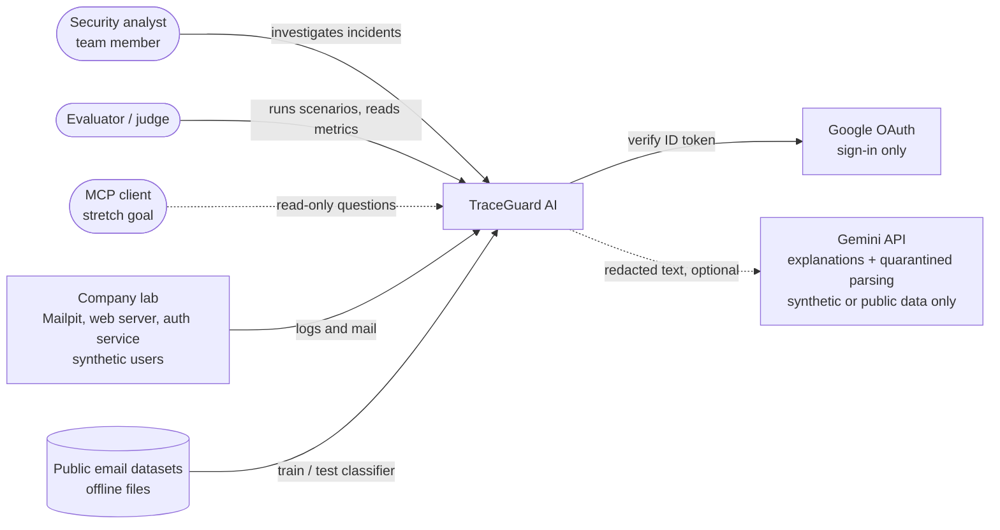

Gemini is optional. The pipeline must produce complete reports with it switched off (template mode).

## 2. Use cases

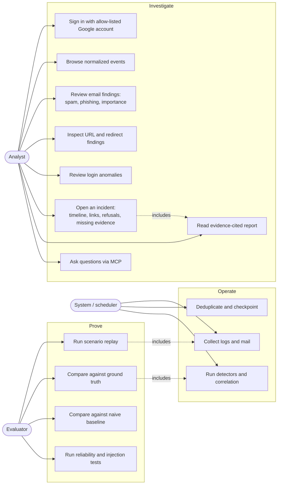

### Use case descriptions

| ID | Use case | Actor | Input | Output | Failure behaviour |
|---|---|---|---|---|---|
| UC1 | Triage a phishing-style email | Analyst | stored email event | findings with evidence IDs, class, confidence, next step | unknown fields shown as `unknown`; never labelled "safe" |
| UC2 | Investigate a login burst | Analyst | auth events | A1-A4 findings, source/account timeline | shared IP flagged as an alternative explanation |
| UC3 | Reconstruct an attack chain | Analyst | findings from all sources | incident with tiered links and timeline | weak links labelled; no causation claims |
| UC4 | See why events were *not* linked | Analyst | candidate pairs | refusal records with reason | listed explicitly, not hidden |
| UC5 | Check a URL | Analyst | URL from an email | normalized URL, redirect chain, risk, limits | unreachable gives `inconclusive` |
| UC6 | Ask "what don't we know?" | Analyst via MCP | question | answer citing event IDs | refuses when no stored evidence |
| UC7 | Measure the system | Evaluator | scenario set + hidden ground truth | precision/recall, link accuracy, vs. baseline | metrics only from real runs |
| UC8 | Stress reliability | Evaluator | duplicate, delayed, dropped logs | pass/fail table | restart resumes from checkpoint |

## 3. Component architecture

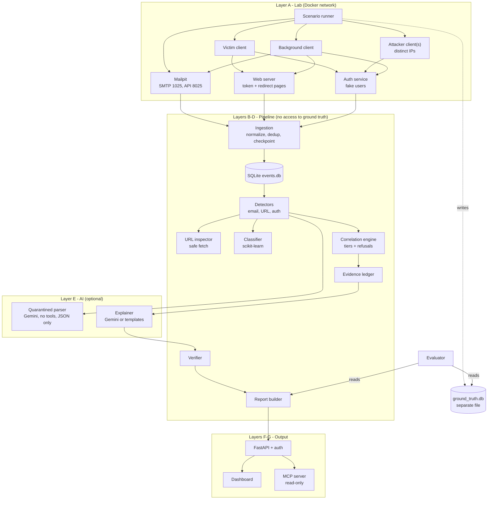

### Component responsibilities

| Component | Responsibility | Must never |
|---|---|---|
| Scenario runner | execute actions, write ground truth | write log lines itself |
| Services (Mailpit, web, auth) | produce their own logs | know about scenarios |
| Ingestion | normalize, deduplicate, checkpoint, record provenance | fabricate missing fields |
| Detectors | deterministic rules with documented thresholds | read ground truth |
| Quarantined parser | turn untrusted email text into schema-validated JSON | call tools or see other data |
| Correlation | link events by shared identifiers, record rejected pairs | link on time proximity alone |
| Ledger and verifier | tie every sentence to event IDs | allow uncited claims |
| MCP / API | read-only access with authorization and audit log | modify state in MVP |
| Evaluator | compare output with ground truth | feed answers back to the detector |

## 4. Deployment (Docker Compose)

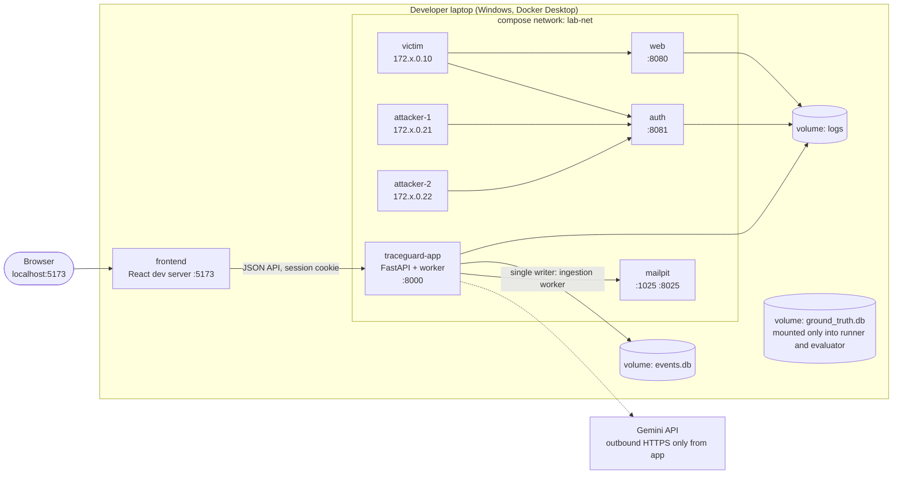

Notes
- Client IPs on the compose network are what make multi-source detections testable. Confirm in Phase 0 that the services see these IPs and not the Docker gateway address.
- `ground_truth.db` is mounted only into the runner and evaluator containers; the app container has no path to it.
- The React app talks only to FastAPI, never to the database. A MongoDB backend can be added later behind the `store/` interface.
- Only `traceguard-app` has outbound internet access, and only to the Gemini host.

## 5. End-to-end workflow

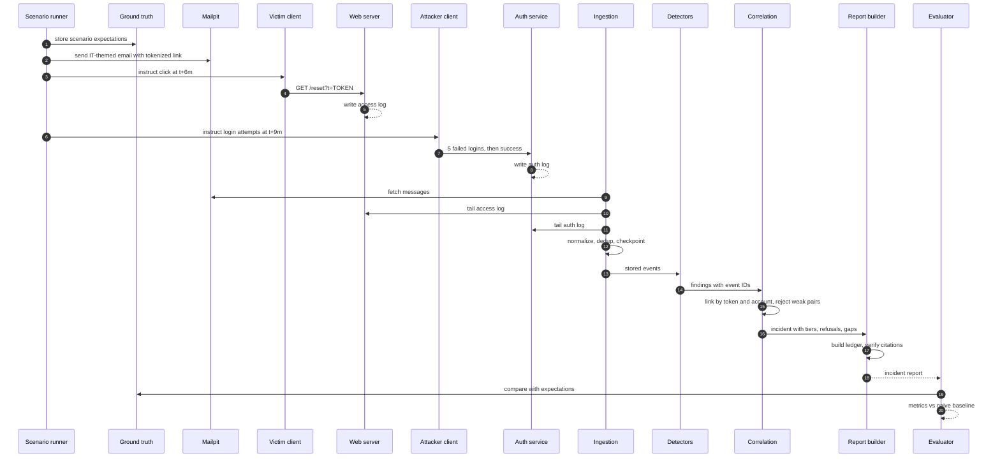

## 6. Event generation workflow

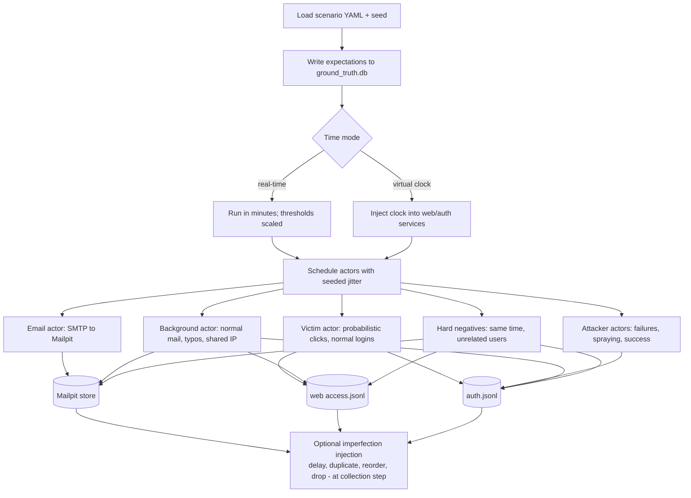

Rule: services write the logs; the runner only acts and records what it *intended* in ground truth.

## 7. Ingestion workflow

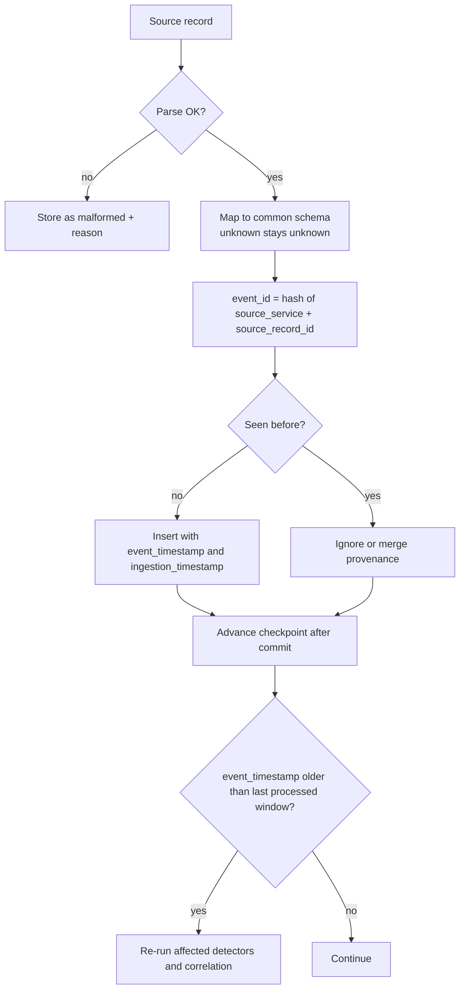

Restart behaviour: on start, read the checkpoint per source and resume; re-ingesting the same input must leave the database unchanged.

## 8. Detection and correlation workflow

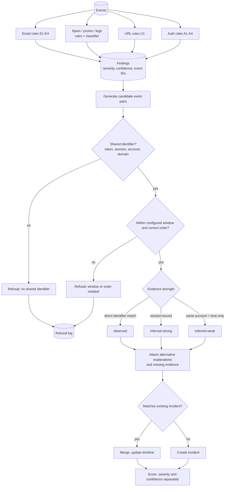

Scoring inputs: severity of behaviour, evidence reliability, number of independent indicators, link strength, missing or contradictory evidence. Output is a category (Informational to Critical) plus a separate confidence label, never a probability.

## 9. Incident report and AI workflow (Gemini)

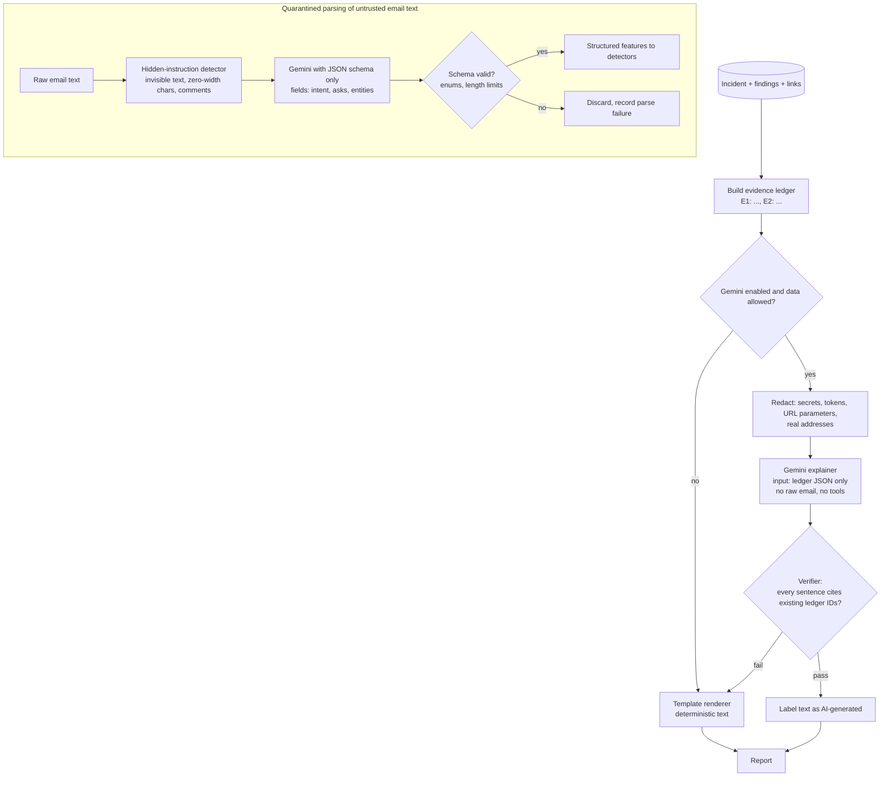

Gemini rules (decided because the free tier may use inputs to improve Google products and may involve human review - see README section 3.7):
- Send **only synthetic lab data and public-dataset text**. Never send real Gmail content, tokens, or personal data.
- Redact before sending. No raw URLs with parameters.
- Use structured output (JSON schema) for the quarantined parser; validate the result server-side anyway.
- Model name comes from `GEMINI_MODEL` in `.env`; do not hardcode. API key lives only in `.env`.
- The reader of untrusted text has no tools and its output is data only; the explainer never sees raw email text.
- Any failure, quota error or timeout falls back to templates; reports must still be complete.

## 10. URL investigation workflow

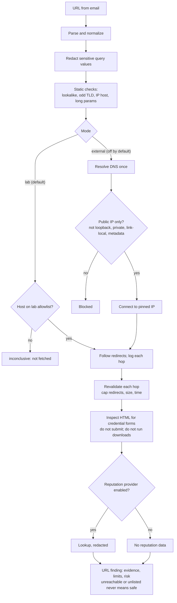

## 11. Sign-in and access workflow

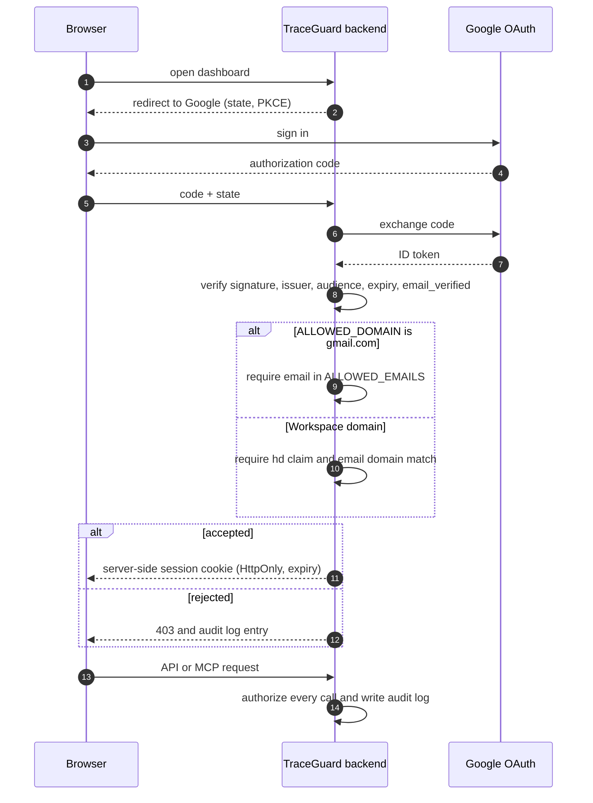

Local fallback: `AUTH_MODE=local` shows a clearly marked fake login so the demo works without Google.

## 12. Evaluation workflow

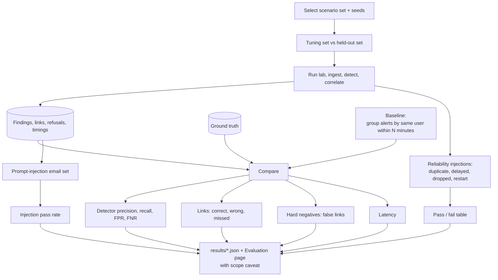

## 13. Classifier training workflow

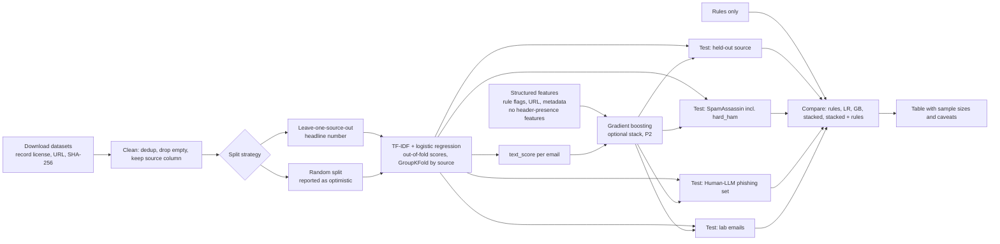

Binary labels in the main dataset mean the claim is "malicious-or-unwanted vs legitimate". Promotional, important and BEC classes use rules and a small hand-labelled sample.

## 14. Data model

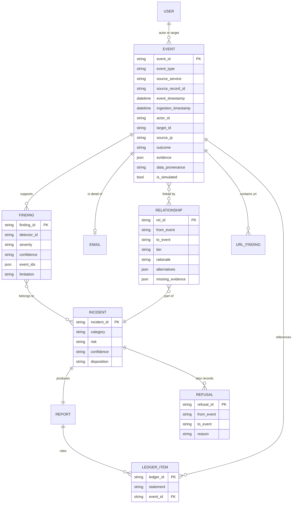

Stored as SQLite tables with JSON columns for nested evidence. `event_id` is the primary key, so ingestion is an idempotent `INSERT ... ON CONFLICT DO NOTHING`. `ground_truth.db` is a separate file the pipeline cannot read. Also stored: `checkpoints`, `audit_log`, `malformed_records`.

## 15. Trust boundaries

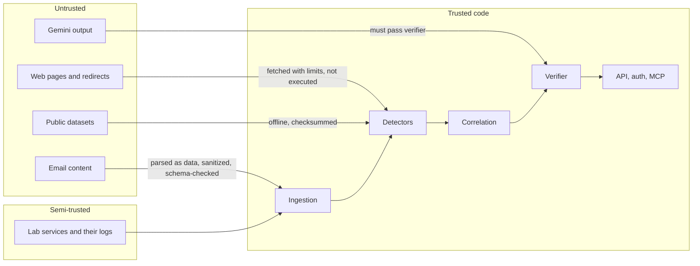

Principles: content crossing from UNTRUSTED to TRUSTED is data only, never instructions; AI output is checked before display; secrets exist only in `.env`.

## 16. What is real, simulated, or not built

| Aspect | Status |
|---|---|
| SMTP delivery, HTTP requests, login checks, service logs | **Real**, produced inside the lab |
| Users, passwords, attacker intent, scenario timing, click behaviour | **Simulated** |
| Public email datasets | **Real emails**, offline, labels from the dataset authors |
| SPF/DKIM/DMARC, geolocation, device data | **Not observable in the lab** |
| Gemini explanations | **Real model output**, labelled AI-generated, verifier-checked; optional |
| Google sign-in | **Real OAuth**, allow-listed Gmail accounts for now |
| Gmail and Workspace login ingestion | **Not built** (documented adapters only) |
| Browser sandbox, auto-remediation | **Not built, by design** |
| MCP server | **Stretch goal** after the demo flow works |
| Metrics | **Produced only by actual runs**; synthetic, same-author scenarios |
