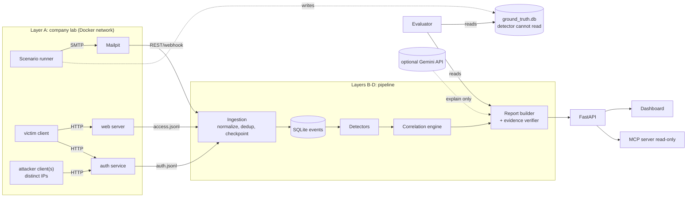

# TraceGuard AI

**From disconnected security events to evidence-based threat investigations.**

> **Status: early build (updated 2026-10-14).** Implemented and tested: the landing page and sign-in
> routing (`frontend/`), dashboard sign-in backend (`traceguard/api/`), the local lab (Mailpit + auth
> service + web server + scenario runner, `lab/`), and ingestion into the common event schema
> (`traceguard/ingest/`). **Not implemented yet:** detectors, correlation, evidence-checked reports,
> evaluator, the real dashboard, MCP, Gemini. Sections below describe the plan unless marked otherwise.
> Evaluation numbers will be added only after they are produced by real runs (none exist yet).

---

## 1. Problem

Security signals live in separate systems: mail, web, authentication. One event alone rarely shows
the whole situation:

- a suspicious email may be harmless,
- repeated login failures may be unrelated to phishing,
- a link in an email does not prove anyone clicked it.

Analysts must decide which events are suspicious, which are related, what evidence supports that,
what is missing, and what to do next.

**TraceGuard AI** collects events from independently running services, applies deterministic
detectors, links related events using defensible evidence, and produces incident reports in which
every statement cites real event IDs. It also reports what it **declines to link** and what it
**cannot conclude**.

### Pitch line
> Alerts tell you what happened. TraceGuard tells you what is connected, what is not, and what it cannot tell.

## 2. Scope

| In scope (core) | Optional (only after core works) | Out of scope |
|---|---|---|
| Local company-like lab generating real events | Gmail / Workspace Reports adapters (stubs + docs) | Auto-blocking, deleting, session revocation |
| Ingestion into one schema (dedup, out-of-order, checkpoints) | Reputation provider (see 3.4) | Browser sandbox / live detonation |
| 5-6 deterministic detectors | Public-dataset validation of the email classifier | Real accounts, real phishing, malware |
| Correlation with confidence tiers and explicit refusals | Gemini for wording and quarantined parsing | Anomaly ML on logins |
| Evidence-checked incident reports | Stacked classifier (gradient boosting + TF-IDF/LR) | Multi-tenant, HA, Kubernetes, Kafka |
| Replay + evaluation vs. a fair baseline | MongoDB as a later storage backend behind the `store/` interface | MongoDB in the 48-hour build |
| SQLite storage | | |
| React + TypeScript + Tailwind dashboard (3-4 pages) | | |
| Read-only MCP server (stretch) | | |
| Domain-restricted Google sign-in for the dashboard (gmail.com + allowlist for now) | | |

## 3. Verification log

Checked on 2026-10-14.

### 3.1 Local environment (this machine) - verified by running commands
| Item | Result |
|---|---|
| Python | 3.12.10 present |
| Docker | 29.8.0 present (daemon/Compose not exercised yet) |
| Node | v24.14.0 present |
| Git | 2.53.0 present |
| Ollama | **not installed** - no local LLM; Gemini API is the optional LLM, template fallback is mandatory |
| Repo | empty git repo, no commits |

### 3.2 Mailpit - verified from official docs
- Default SMTP port **1025**; default web UI + REST API port **8025**.
- Webhook on new message via `MP_WEBHOOK_URL` (`--webhook-url`), with rate limit option.
- Docs list **no SPF/DKIM/DMARC validation option**. Treat Mailpit as a capture inbox only.
- The docs page I fetched did **not** list endpoint paths. Exact endpoints must be read from the
  Swagger file served by the running instance (`http://localhost:8025/api/v1/`) before writing the client.

Sources: [API overview](https://mailpit.axllent.org/docs/api-v1/), [runtime options](https://mailpit.axllent.org/docs/configuration/runtime-options/)

### 3.3 Consequence for the design
- SPF/DKIM/DMARC cannot be observed in the lab. Detectors must treat these fields as
  `unknown` there, never fabricate them. They are evaluated only on a unit-test level with
  clearly labelled fixture headers.

### 3.4 Threat-intel reputation - verified from search results, not primary docs
- Google Safe Browsing v4 is documented as **non-commercial use only**, no cost, default quota.
- The Lookup API sends URLs **unhashed** to Google (privacy implication for secret-bearing URLs).
- If a warning is shown to users, attribution and a no-guarantee notice are required.
- Lab URLs will never appear in any feed, so the live reputation path is **untestable locally**;
  it is tested with a mock only. Decision: reputation is optional and off by default.

Source: [Safe Browsing usage limits / terms](https://developers.google.com/safe-browsing/v4/usage-limits)

### 3.5 MCP SDK - partly verified
- Official package is `mcp` on PyPI (module `mcp.server.fastmcp`). A separate third-party
  `fastmcp` package exists; do not mix them.
- Sources disagreed on v1 vs v2 being current. **Action:** check PyPI and pin an exact version
  (a `<2` pin was suggested by one source) before writing server code.

Source: [MCP Python SDK docs](https://py.sdk.modelcontextprotocol.io/)

### 3.6 Public datasets - researched 2026-10-14

**Finding: no single public dataset contains all the email types this project wants.**
Public sets label *phishing / spam / legitimate*. I found none that labels *promotional*,
*important/action-required*, or *CEO-fraud/BEC* messages. Plan around that instead of pretending otherwise.

| Dataset | What it gives | Labels | License / terms | Status |
|---|---|---|---|---|
| **"Phishing Email Dataset"** (Kaggle, naserabdullahalam) - merge of Enron, Ling-Spam, CEAS 2008, Nazario, Nigerian Fraud, SpamAssassin | ~82k emails; reported as ~42.7k phishing/spam vs ~39.6k legitimate (sources disagree slightly: 42,675/39,580 vs 42,891/39,595) | **binary** (phishing-or-spam vs legitimate) | Listed CC BY-SA 4.0 on Kaggle search snippet; asks for citation. I could not open the page to confirm | **Primary candidate**, license to be confirmed on download |
| **SpamAssassin public corpus** (official) | 6,047 messages: spam 500, easy_ham 2,500, hard_ham 250, easy_ham_2 1,400, spam_2 1,397; full headers; `hard_ham` is useful hard negatives | spam / ham | No formal license; copyright stays with original senders; **do not send into a live mail system**; asks to be told about papers using it | Verified from official readme; use only for local replay |
| **Human-LLM generated phishing/legitimate emails** (Kaggle, francescogreco97) | ~4,000 emails, human-written and LLM-written, phishing and legitimate | phishing / legitimate, human vs LLM | CC BY-NC-SA 4.0 (non-commercial: fine for a hackathon) | Search snippet only; page could not be opened. Good **held-out "AI-written phishing" test set** |
| Nazario phishing corpus | ~4.5k hand-screened phishing mails | phishing only | No license found; original host page not confirmed | Use only via the merged set |
| Enron (CMU) | large benign business mail corpus | none | CMU asks users to respect privacy of people in it; license unconfirmed | Optional source of realistic ham/"business" text; large (1.7 GB) |
| IEEE DataPort multi-source set (with SPF, URL, structural features) | 5 sources unified | phishing / spam / legitimate (3-class) | not shown; may need an IEEE account | Unverified, worth checking: only found **3-class** candidate |
| MeAJOR corpus (arXiv 2507.17978) | 135,894 samples | not stated on the page | dataset license not stated (paper is CC BY) | No download link found |

Sources: [Kaggle search results](https://www.kaggle.com/datasets/naserabdullahalam/phishing-email-dataset),
[SpamAssassin corpus readme](https://spamassassin.apache.org/old/publiccorpus/readme.html),
[Human-LLM dataset](https://www.kaggle.com/datasets/francescogreco97/human-llm-generated-phishing-legitimate-emails),
[IEEE DataPort multi-source](https://ieee-dataport.org/documents/multi-source-phishing-spam-ham-email-dataset-spf-url-and-structural-features),
[MeAJOR](https://arxiv.org/abs/2507.17978),
[CMU Enron](https://www.cs.cmu.edu/~enron/).

**How we will use them**
1. **Train + test the phishing/spam classifier on the merged Kaggle set.** Beware *source leakage*:
   Enron is all-legitimate and Nazario/Nigerian are all-malicious, so a model can learn the
   source's formatting instead of phishing. Therefore evaluate with **leave-one-source-out**
   splits where source information is kept, and report that number, not only a random split.
2. **SpamAssassin** (with `hard_ham`) as a second, separately held-out test and as hard negatives.
3. **Human-LLM set** as a held-out test of AI-written phishing (generalization claim).
4. **Promotional / important / action-required / BEC:** no public labels. Use rules, and evaluate
   on a small hand-labelled sample (~100-200 emails; each member labels, record agreement).
   Do **not** claim classifier accuracy for these classes.
5. Record license, source URL, download date and SHA-256 for every file in `eval/external/DATA.md`.
   Datasets stay out of git. Replay through Mailpit stays local.
6. Binary labels mean we cannot separately report *spam vs phishing* accuracy from this set;
   claim "malicious-or-unwanted vs legitimate" unless the 3-class IEEE set is confirmed usable.

### 3.7 Gemini as the LLM - researched 2026-10-14 (third-party sources, not primary docs)
- Reports consistently say the **free tier may use submitted content to improve Google products and may involve human review**; paid-tier terms say content is not used. Billing state decides which terms apply. Confirm in Google's own Gemini API terms before relying on this.
- Free-tier rate limits are not guaranteed; check the live limits in AI Studio. Never design around a fixed number.
- Structured output with a JSON schema is supported via the `google-genai` Python SDK. Sources disagree on the parameter name (`response_schema` vs `response_json_schema`); check the installed SDK version.
- **Consequences adopted:** send only synthetic lab data and public-dataset text, never real Gmail content, tokens or personal data; redact before sending; model name and key in `.env` (`GEMINI_MODEL`, `GEMINI_API_KEY`); template fallback on any failure; validate all model output server-side.
- This supersedes "no LLM" in earlier notes: Gemini is optional and replaces the local-LLM plan. "No paid API" still holds if we stay on the free tier.

Sources: [Gemini API terms preview](https://ai.google.dev/gemini-api/terms_preview),
[Gemini structured output docs](https://ai.google.dev/gemini-api/docs/json-mode),
[Simon Willison on the terms](https://simonwillison.net/2024/Oct/17/gemini-terms-of-service)

### 3.8 Phase 0 results (run 2026-10-14) and what is still unverified

**Resolved by running it:**
- **Docker is not required, and was not usable.** The Docker CLI (29.8.0) is installed but the engine was not running. The lab therefore
  runs as local processes (`python -m lab.up`); Compose remains optional.
- **Distinct source IPs work natively.** A server on `127.0.0.1` observed clients bound to `127.0.0.10`, `.21`, `.22` as three separate
  peers (the whole loopback `127.0.0.0/8` range is usable). The lab relies on this.
- **Mailpit v1.31.5** (Windows binary, SHA-256 `9637e21c…e199e8dc` matched GitHub's published digest; same-origin check, not an
  independent signature) serves `GET /api/v1/messages`, `/message/{ID}`, `/message/{ID}/headers`, `/message/{ID}/raw`. Returned fields:
  `From{Name,Address}`, `To`, `ReplyTo`, `Subject`, `Created` (receive time), `MessageID`, `Text`, `HTML`, `Attachments`, stable `ID`.
- **No `Authentication-Results` / `Received-SPF` header is produced**, confirming SPF/DKIM/DMARC are `unknown` in the lab.
- The Mailpit docs page did not list endpoints; the list above comes from the Swagger file the running instance serves.

**Still unverified:**
- Google OAuth `hd` behaviour and a real Google round trip (needs a real OAuth client; only the code paths with Google calls replaced are tested).
- Gemini model choice, structured-output parameter name, and free-tier quota for our scenario volume.
- Kaggle dataset licence, columns and per-source counts (not downloaded yet).

## 4. Architecture



Key properties:
- The generator **acts**; services write their own logs. The generator never writes log lines.
- The detector has **no access** to `ground_truth.db`, scenario IDs, or generator code.
- The pipeline works with no MCP client and no LLM.

## 5. Directory structure (planned)

```
traceguard/
  README.md
  .env.example                  placeholders only
  docker-compose.yml            mailpit, web, auth, clients, app
  pyproject.toml / requirements.lock
  config/
    detection.yaml              thresholds, windows (tunable)
    scenarios/*.yaml            scenario definitions (+ seed)
  lab/
    auth_service/               FastAPI, JSONL log, injectable clock
    web_server/                 FastAPI, JSONL log, token + redirect pages
    clients/                    victim / attacker / background actors
    runner.py                   executes scenarios, writes ground truth
  traceguard/
    schema.py                   Event, Finding, Relationship, Incident
    ingest/                     mailpit.py, jsonl_tail.py, checkpoint.py, dedup.py
    detect/                     email.py, url.py, auth.py (one rule per function)
    correlate/                  rules.py, tiers.py, refusals.py
    report/                     builder.py, ledger.py, verifier.py, templates/
    ai/                         quarantine.py, explainer.py, classifier.py
    url_inspect/                normalize.py, safe_fetch.py, lookalike.py
    store/                      base.py (interface), sqlite.py, models, retention.py
    api/                        FastAPI routes, auth (Google OAuth)
    mcp_server/                 tools.py (read-only)
  eval/
    evaluate.py                 reads ground truth, writes results/*.json
    baseline.py                 naive same-user-time-window grouping
    external/                   optional public-dataset scripts
  frontend/                     React + TypeScript + Tailwind (Vite)
  tests/                        unit, integration, reliability, security
```

## 6. Technology choices

| Concern | Choice | Reason |
|---|---|---|
| Language | Python 3.12 | present on machine |
| Services/API | FastAPI | lightweight, typed |
| Mail capture | Mailpit | verified free, SMTP+REST |
| Storage | **SQLite** (WAL, stdlib `sqlite3`), JSON columns for nested evidence | zero setup, one file per database. Decision after comparing with MongoDB: Mongo adds a container, auth and index setup on Day 1 for no benefit judges can see, and a separate `ground_truth.db` file isolates better than a second Mongo database |
| Storage interface | thin `store/` layer with SQLite as the only implementation | lets a MongoDB backend be added later without touching detectors |
| Dashboard | **React + TypeScript + Tailwind** (Vite), talking to FastAPI JSON endpoints | team decision. Costs roughly a day of work; keep to 3-4 pages (see 15, 18) |
| MCP | official `mcp` package, pinned | see 3.5 |
| LLM | optional Gemini API (free tier) via `google-genai`; template fallback | no local LLM available; see 3.7 for data-handling limits |
| ML | scikit-learn: TF-IDF + logistic regression; optional gradient boosting stacked on top | cheap, explainable, measurable; see 11 |
| Tests | pytest | |
| Orchestration | Docker Compose | distinct container IPs |

Pin every dependency in a lockfile (`requirements.lock`, `package-lock.json`). No Kafka, Kubernetes or further databases.

**SQLite rules**
- Tables: `events`, `emails`, `findings`, `relationships`, `refusals`, `incidents`, `url_findings`, `reports`, `audit_log`, `checkpoints`, `malformed_records`. Nested evidence in JSON columns.
- `events.event_id` is `PRIMARY KEY`; ingestion uses `INSERT ... ON CONFLICT DO NOTHING`, which gives deduplication and restart-safe re-ingestion. Commit the checkpoint in the same transaction as the events it covers.
- WAL mode; one writer (the ingestion worker); API connections are read-only. Indexes on `event_timestamp`, `actor_id`, `target_id`, `source_ip`, `event_type`.
- **Ground truth is a separate file, `ground_truth.db`**, mounted only into the runner and evaluator containers.
- Always use parameterized queries; never format SQL from request or email content.
- Retention: a scheduled delete by timestamp, with the policy stated in the README.
- If MongoDB is wanted later, implement a second `store/` backend; do not leak SQL into detectors.

**React rules**
- Vite + React + TypeScript + Tailwind; charts with a small library (e.g. Recharts), link graph with React Flow or similar. Choose and pin at build time.
- Email bodies are rendered as **plain text**; if HTML preview is needed, sanitize with DOMPurify and render in a sandboxed iframe. No `dangerouslySetInnerHTML` on raw content.
- Auth by HttpOnly server-side session cookie; no tokens in `localStorage`. CORS limited to the dev origin.
- All data comes from FastAPI JSON endpoints; the frontend never touches the database.

## 7. Event schema

Single normalized record; unknown fields stay **absent or `"unknown"`**, never invented.

| Field | Notes |
|---|---|
| `event_id` | deterministic hash of (`source_service`, `source_record_id`) - gives dedup |
| `event_type` | `email_received`, `web_request`, `auth_attempt` |
| `source_service` / `source_record_id` | provenance |
| `event_timestamp` | from the source |
| `ingestion_timestamp` | when we saw it (delay measurement) |
| `actor_id` / `target_id` | stable user IDs (lab users) |
| `source_ip`, `destination`, `outcome` | as observed by the service |
| `evidence` | raw relevant fields (JSON) |
| `data_provenance` | `lab-service` / `imported` / `real-workspace` |
| `is_simulated` | always shown in UI |

Other collections: `emails`, `findings`, `relationships`, `refusals`, `incidents`, `url_findings`,
`reports`, `audit_log`, `checkpoints`. `ground_truth` lives in a **separate SQLite file** mounted only
into the runner and evaluator containers.

## 8. Event generation

Principle: **actions cause logs; logs are never hand-written.**

- **Email actor** - `smtplib` to Mailpit :1025. Templates with seeded randomization:
  legitimate, announcements, promotional, spam, phishing, lookalike sender. Phishing links carry
  a per-recipient token (`/reset?t=...`).
- **Victim actor** - opens some links via HTTP (probabilistic per scenario), logs in normally.
  Web server logs path, token, status, IP, session, referrer, redirect hops.
- **Attacker actors** - separate containers (distinct IPs) making real requests to the auth
  service with fake credentials: brute force, spraying, distributed, success-after-failures.
- **Background actor** - normal mail, normal logins, typos, shared office/VPN IP.
- **Hard negatives** - phishing to Alice while an unrelated burst hits Bob; click and login for
  the same user hours apart; shared IP across unrelated users.
- **Imperfection injection** (at the *collection* step): delays, duplicates, reordering, dropped lines.
- **Randomization** - seeded names, timing jitter, user-agents, wording, so detectors cannot key on artifacts.
- **Time** - two explicit modes, recorded per run:
  - *real-time*: minutes-long scenarios, scaled thresholds (required for email, since Mailpit stamps receive time),
  - *virtual-clock*: auth/web services accept an injectable clock for baseline history.

Scenario sketch:

```yaml
id: phish_then_takeover_01
seed: 4172
actors:
  - {type: email, at: t+0m, from: it-support@c0mpany-portal.lab, to: alice, template: it_password_reset}
  - {type: victim_click, user: alice, at: t+6m, probability: 1.0}
  - {type: auth_attempts, client: attacker-1, target: alice, failures: 5, then: success, at: t+9m}
ground_truth:            # written to ground_truth.db only
  related: [email, click, auth_burst]
  expected_link_email_to_auth: weak
```

## 9. Detectors

Every rule documents: inputs, threshold and window (from `detection.yaml`), logic, severity,
limitation, expected output, and tests.

| ID | Detector | Key inputs | Known limitation |
|---|---|---|---|
| E1 | Sender/Reply-To mismatch | From, Reply-To | legit mailing lists |
| E2 | Lookalike domain | sender/link domain vs. org + brand list | edit-distance false positives |
| E3 | Credential/payment/urgency request | body text | keyword evasion; context needed |
| E4 | Risky attachment | type, extension, size | benign macros/zips |
| E5 | Spam/promo/legit classification | rules (+ optional ML) | promo != malicious |
| U1 | URL structure + redirect chain | URL, hops | secret-bearing links redacted |
| A1 | Repeated failures, one account | account, outcome, window | typos, lockouts |
| A2 | One source -> many accounts (spraying) | IP, accounts | NAT/VPN shared IPs |
| A3 | Many sources -> one account | IPs, account | travel, mobile networks |
| A4 | Success after failures | sequence | forgot-password flows |

Email output classes: likely legitimate / suspicious / likely phishing / inconclusive. There is
**no "safe"** class; absence of indicators is not proof of safety. "Confirmed" exists only for
simulation ground truth in the evaluator, never in live detection.

## 10. Correlation

Link types, each with a rule, evidence, and tier:

| Link | Basis | Tier |
|---|---|---|
| email -> web visit | same per-recipient token in URL and request | **observed** |
| web visit -> auth events | same user/session | **inferred-strong** if session-bound, else **inferred-weak** |
| email -> auth events | same target within window, no click evidence | **inferred-weak** |
| auth <-> auth | same account/IP within window | observed (as grouping) |

Rules:
- Time proximity alone never creates a link. At minimum a shared identifier is required.
- Each link stores rationale, supporting event IDs, **alternative explanations** (e.g. shared IP, coincidence), and missing evidence.
- Pairs that were evaluated and **rejected** are stored with the reason (the "refusal" record).
- Incidents are deduplicated by evidence set; late events merge into existing incidents.
- "Email caused logins" is never asserted; the report says what is and is not established.

## 11. AI layer (measured, not decorative)

1. **Evidence Ledger + verifier.** Reports are built from typed evidence items
   (`E7: Reply-To domain differs from From`). The explainer may only cite ledger IDs; the
   verifier rejects sentences citing nonexistent or irrelevant IDs. Without an LLM, templates
   produce the same structure.
2. **Quarantined LLM (optional, Gemini).** The model that reads raw email text has no tools and returns
   a schema-validated JSON (intent, claims, entities). It never sees tool outputs; privileged
   code consumes only the JSON. Only synthetic/public text is ever sent (see 3.7). Test set:
   prompt-injection emails, with a reported pass rate. Now feasible because Gemini is available;
   still P1 for the 48-hour schedule.
3. **Hidden-instruction detector.** Flags invisible text, zero-width characters, HTML comments
   and instruction-like phrasing aimed at AI assistants.
4. **Classifier.** Baseline: TF-IDF + logistic regression (P0 of the ML work). Optional stack (P2):
   gradient boosting (scikit-learn `HistGradientBoostingClassifier`) on structured features
   (rule flags, URL features, metadata) plus the logistic-regression score.
   - The logistic score fed to boosting must be **out-of-fold** (cross-validated predictions), with
     **group-aware CV by source** (`GroupKFold`), otherwise test numbers are inflated.
   - Exclude header-presence features from the trained model: missing headers reveal the dataset source.
   - Report all of: rules only, logistic regression, boosting alone, stacked, stacked + rules, on
     leave-one-source-out, SpamAssassin and the Human-LLM set. If the stack does not beat the
     logistic baseline, ship the baseline and say so.
   - The model output is one evidence item (with top contributing features), never the sole verdict
     and never a calibrated probability claim.
5. **Campaign grouping (stretch).** Embedding similarity to group reworded phishing across users.

AI never creates events, never upgrades an uncertain link to confirmed, and every AI-written
sentence is labelled as AI-generated.

## 12. URL investigation

- Normalize and parse safely; redact sensitive query values in logs and any external query.
- **Lab mode (default):** only hostnames on an explicit lab allowlist are fetched.
- **External mode (off by default):** resolve DNS once, reject non-public IPs (loopback,
  private, link-local, cloud metadata), connect to the pinned IP, **re-validate every redirect
  hop**, cap redirects/body size/time, never execute downloads, never submit forms.
- Unreachable or unlisted URL is `inconclusive`, never "safe".
- Reputation lookup is a pluggable provider, mocked in tests (see 3.4).
- No browser sandbox in MVP; static fetch + HTML form inspection only.

## 13. Authentication and access control (dashboard)

- Google OAuth sign-in; allowed domain and client config only in environment variables.
- **For now: `ALLOWED_DOMAIN=gmail.com`** (decision: no Workspace domain available). Switch the
  variable to an organization domain later; no code change.
- Consumer Gmail accounts have **no `hd` claim**, so the `hd` check applies only when the
  configured domain is a Workspace domain. For `gmail.com`, `ALLOWED_DOMAIN` alone would admit
  *every* Gmail user, so also require `ALLOWED_EMAILS` (explicit allowlist of the two team
  members) while the domain is gmail.com. Startup fails if the domain is gmail.com and the allowlist is empty.
- Backend verifies the ID token: signature, issuer, audience, expiry, `email_verified`, and
  the `hd` claim / email domain. Frontend checks do not count.
- Server-side sessions with expiry and logout; refresh tokens (if Gmail is ever added) encrypted at rest.
- Sign-in permission is separate from any Gmail/Workspace data access.
- Local dev mode with a clearly marked fake login so the demo works offline.
- Optional Gmail / Reports adapters: documented limits (restricted scopes, admin privileges,
  incomplete login coverage). Real and simulated events never share a view without labels.

## 14. MCP server (read-only)

About 8 tools, all validated, authorized, audit-logged, and querying stored records only:

`search_emails`, `analyze_email`, `analyze_url`, `search_auth_events`,
`find_source_across_accounts`, `list_incidents`, `get_incident_evidence`, `evaluate_detection_results`.

Tool outputs and email/web content are treated as untrusted data. No mutating tools in MVP.

## 15. Dashboard

Pages: Overview, Event Explorer, Email Intelligence, URL Investigation, Authentication,
Incident Explorer (timeline + link graph + refusals + missing evidence), Evaluation.
Distinct labels: *service-generated*, *synthetic identity*, *simulated scenario*, *finding*,
*AI-generated interpretation*. HTML from emails is sanitized before rendering.

## 16. Evaluation

Everything below is produced by actual runs; nothing is pre-filled.

| Question | Measure |
|---|---|
| Do detectors work? | precision, recall, FPR, FNR per detector |
| Does correlation add value? | correct / wrong / missed links vs. ground truth; **vs. baseline** "group by same user within N minutes" |
| Do hard negatives stay unlinked? | false-link count |
| Is it fast? | detection latency (event time to finding) |
| Is it reliable? | duplicates, out-of-order, dropped lines, restart-and-resume |
| Is the AI safe? | prompt-injection pass rate; ledger verifier rejection rate |
| External check (optional) | email classifier on held-out public data; train/test never overlap |

Methodology rules:
- Held-out scenarios not used to tune thresholds; fixed seeds; multiple runs with a spread.
- Report lab results as **synthetic, same-author scenarios**. They do not support real-world accuracy claims.
- If a public dataset is used: record source, license, checksum, split. Report both
  public->public and public->lab, plus rules-only and hybrid baselines.
- Correlation is evaluated only on lab data (public email sets have no linked web/auth logs).

## 17. Threat model (the platform itself)

| Threat | Mitigation |
|---|---|
| Prompt injection via email/web content | quarantined LLM, schema-only handoff, no tools in the reader, injection test set |
| SSRF / DNS rebinding in URL module | allowlist (lab) / pinned public-IP fetch with per-hop revalidation (external) |
| Malicious HTML in the dashboard | sanitize, CSP, no inline scripts from email content |
| Token/secret leakage | env-only secrets, encrypted refresh tokens, log redaction |
| Unauthorized dashboard/MCP access | server-side domain check, per-call authorization, rate limits, audit log |
| Evidence tampering | append-only event table, source provenance, checkpoints |
| Detector sees the answer | ground truth in a separate file/container, no scenario IDs in events |
| Overclaiming | tiers, refusal records, missing-evidence section, labelled AI text |

## 18. Build plan

Constraints (confirmed): **48 hours, 2 people, no Workspace domain (use gmail.com + allowlist), no local LLM
(Gemini optional, templates as fallback).** Priorities: **P0** = needed for the demo, **P1** = strengthens claims,
**P2** = only if time remains.

### 48-hour schedule (two people)

| Block | Person A (lab + pipeline) | Person B (detection + data + UI) |
|---|---|---|
| Day 1 AM (4h) | Phase 0 spikes, then Phase 1 lab: Compose, auth/web services, runner | Download datasets, record license/checksum; train baseline classifier; define schema with A |
| Day 1 PM (4h) | Phase 2 ingestion (dedup, checkpoint) | Phase 3 detectors E1-E4 + A1-A4 with tests |
| Day 1 eve (2h) | Run first scenario end to end | Leave-one-source-out evaluation of classifier |
| Day 2 AM (4h) | Phase 4 correlation + refusals | Phase 6 ledger + template reports; Phase 5 evaluator + baseline |
| Day 2 PM (4h) | Phase 7 React scaffold + Incident Explorer (timeline, link graph, refusals) | Evaluation page and Event Explorer in React, Google sign-in with allowlist, hard-negative scenario |
| Day 2 eve (2h) | Freeze; rehearse demo; record fallback video | README numbers from real runs; MCP tools only if everything else is green |

Not feasible in 48h with two people: Phases 9 (LLM parts), 10 replay-through-Mailpit of full datasets,
12 integrations. Treat the classifier as scikit-learn only and the "AI explainer" as the ledger + templates.
The MCP server (Phase 8) is a stretch goal; do it after the demo flow is reliable.

| Phase | Work | Exit criterion | Pri |
|---|---|---|---|
| 0. Spikes | Run Mailpit in Compose; confirm API endpoints from its Swagger; confirm container IPs seen by services; pin `mcp` version | Notes written; assumptions in 3.8 resolved or changed | P0 |
| 1. Lab | auth + web services with JSONL logs; clients; runner; ground-truth store | One scenario run produces mail, web and auth logs with no hand-written lines | P0 |
| 2. Ingestion | Common schema, dedup, checkpoint, delayed/duplicate handling, event explorer | Re-ingesting the same logs changes nothing; restart resumes | P0 |
| 3. Detectors | E1-E4, A1-A4, URL redirect/lookalike, each with tests | Each rule has passing positive and negative tests | P0 |
| 4. Correlation | Tiers, refusals, incident dedup, timeline | Attack scenario links; unrelated-users scenario yields a refusal record | P0 |
| 5. Evaluation | Evaluator, baseline, held-out scenarios, results JSON | Reproducible report from a fixed seed | P0 |
| 6. Reports + ledger | Evidence ledger, verifier, template reports | Verifier rejects a fabricated citation in a test | P0 |
| 7. Dashboard (React) | Incident Explorer, Event Explorer, Evaluation; Overview if time | Demo runs end-to-end from UI | P0 |
| 8. MCP | ~8 read-only tools, authz, audit log | An MCP client answers "what don't we know about incident X?" from stored records | P1 |
| 9. AI | Quarantine LLM, hidden-instruction detector, classifier + comparison | Injection test set run; three-way comparison table produced | P1 |
| 10. External data | Public dataset split + replay through Mailpit | Held-out number with license/checksum recorded | P2 |
| 11. Hardening | Auth tests, SSRF tests, storage-failure tests, README polish | Security test suite green | P1 |
| 12. Integrations | Gmail / Reports adapters | Documented stubs; real use only with authorization | P2 |

Cut order if short on time: 12, 10, stacked classifier, campaign grouping, 9 (keep the ledger), most of 8,
then reduce React to 3 pages (Incident Explorer, Event Explorer, Evaluation).

Schedule risk of the React decision: Day 2 needs a working React shell early. Build the FastAPI JSON endpoints
for incidents and evaluation on Day 1 evening so the frontend is never blocked by the backend.

## 19. Demo (about 3 minutes)

1. `docker compose up`, run the attack scenario live.
2. Event Explorer shows raw alerts from three services; Incident Explorer shows **one** grouped
   incident with the evidence timeline and tiers.
3. Run the look-alike scenario with unrelated users: the system **refuses to link** and shows why.
4. Ask the MCP client what is not known about the incident; the answer cites event IDs.
5. Show the injection email being neutralized (if Phase 9 done).
6. Evaluation page: engine vs. baseline, with the scope caveat on screen.
7. Fallback: a pre-recorded run in case live services fail.

## 20. Setup

**Works today** (Windows, Python 3.12; commands are from the repo root):

```bash
pip install -r requirements.txt
# Mailpit: download mailpit-windows-amd64.zip (v1.31.5), verify its SHA-256, extract mailpit.exe into tools/mailpit/bin/
python -m lab.up --fresh                                   # Mailpit + lab auth + lab web (127.0.0.1 only); Ctrl-C stops
python -m lab.runner config/scenarios/phish_then_takeover.yaml --time-scale 0.02 --seed 7   # acts; services write their own logs
python -m traceguard.ingest --once                         # normalise + store into data/events.db (re-running changes nothing)
python -m pytest tests -q                                  # 66 tests; the lab integration tests start their own lab on other ports
```

Scenarios: `phish_then_takeover`, `hard_negative_unrelated`, `password_spray`, `benign_day`. The runner writes its answer key to
`data/ground_truth.db`, which the ingestion and (future) detection code never open.

Dashboard sign-in backend and frontend (see `.env.example`; `AUTH_MODE=local` is a development-only login):

```bash
uvicorn --factory traceguard.api.main:create_app --port 8000
cd frontend && npm install && npm run dev                  # http://localhost:5173, proxies /api to :8000
```

**Planned, not built:** detectors, correlation, evaluator (`python -m eval.evaluate`), reports, MCP server, Docker Compose.

`.env.example` contains placeholders only (`ALLOWED_DOMAIN`, `ALLOWED_EMAILS`, `GOOGLE_CLIENT_ID`, `GOOGLE_CLIENT_SECRET`,
`OAUTH_REDIRECT_URI`, local-demo passcode, session TTL, cookie flag).

## 21. Limitations and honesty statement

- All lab data is synthetic and written by the same team as the detectors; metrics describe the lab only.
- SPF/DKIM/DMARC, geolocation and device data are not observable in the lab.
- Click evidence exists only because the lab uses per-recipient tokens; real environments rarely have it.
- Reputation checks cannot be validated against lab URLs.
- Google Workspace login reports do not cover every authentication attempt; Gmail read scopes
  are restricted and need approval beyond test users. These must be re-checked in the official docs before use.
- No automatic remediation exists, by design.

## 22. Open questions

Resolved:
1. Duration/team: **48 hours, 2 people** (see 18).
2. Domain: **gmail.com with an explicit email allowlist** for now; local fake-login mode as fallback (see 13).
3. LLM: **no local LLM; Gemini API (optional)** with template fallback (see 3.7). Storage: **SQLite** behind a `store/` interface (MongoDB considered and deferred). Frontend: **React**.
4. Dataset: see 3.6; no single dataset covers all classes.

Still open:
1. Confirm Kaggle merged-set license, columns and per-source counts after download.
2. Is the IEEE DataPort 3-class set accessible without payment?
3. Who hand-labels the ~100-200 promotional/important/BEC sample, and how is agreement measured?
